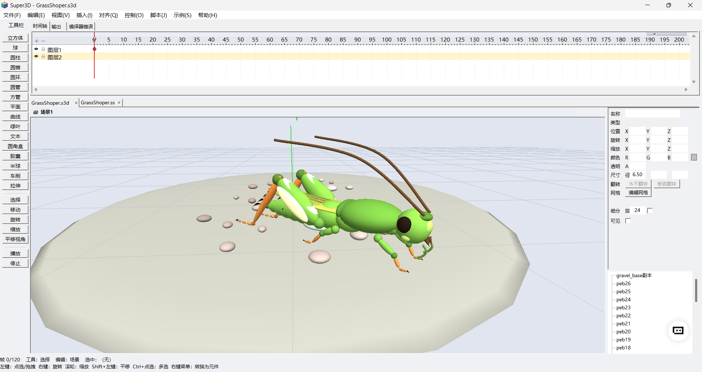

# Super3D — 3D Scene Designer for Kids (MFC + OpenGL)

Super3D is an easy-to-use 3D scene design tool: place cubes, spheres, cylinders, cones, torus and planes with the mouse, keyframe animations on a timeline, and drive the scene with a lightweight scripting language (**SuperScript**) — variables, functions, arrays, events and math. Full Chinese UI and Chinese keyword aliases.



🪳 **[在线预览蚂蚱动画](https://fmser.github.io/Super3D/)** — 浏览器里直接打开，可旋转/播放

## Features

- **3D scene editing** — 6 primitives + groups, scene tree, property panel, move/rotate/scale gizmos
- **Grouped-object workflow** — group / copy / break apart, unlimited nesting
- **Timeline keyframe animation** — auto tweening between keyframes, loop playback
- **Keyframe scripts** — right-click a keyframe to attach a frame action script (runs once when the playhead enters the frame)
- **Document Class (.ss)** — one `ProjectName.ss` file (same name & directory as the `.s3d`), `package/class/extends` syntax with a `super3d.Object3D` base class; constructor runs once, `onEnterFrame` fires every frame, keyboard events work for the whole program lifecycle
- **Code editor** — syntax highlighting, code auto-complete (`mc.` → property list), auto-indent on Enter, Ctrl+F formatting, Ctrl+A/C/V/X/Z, Ctrl+S save
- **Six built-in English examples** — House, Windmill, SolarSystem, BounceBall, DocClass, TankBattle (each in its own folder under `sample\`)
- **Standalone player** — drag a `.s3d` onto Super3DPlayer.exe to play without the editor; one-click packaging produces a self-running exe
- **Export to Three.js** — a single offline HTML page (Three.js embedded), viewable in any browser
- **Built-in MCP server** — an MCP (Model Context Protocol) endpoint at `http://127.0.0.1:8765/mcp` (JSON-RPC 2.0, loopback only) with 23 tools: list/get/add/transform/color/keyframe/script — AI assistants can drive scene editing directly

## Quick Start

- **Build**: Visual Studio 2019 — open `Super3D.sln`, build `Release|Win32` (or x64).
- **Run**: launch `Win32\Release\Super3D.exe`.
- **Try it**: menu 【示例】(Example) → load one of the six examples → 【播放】(Play).
- **Document Class**: menu 【文件 → 文档类脚本…】(File → Document Class…) or click the `.ss` tab; type `mc.` in the editor to see code auto-complete.

## Built-in Examples

| Example | Folder | Content |
|---|---|---|
| House | `sample\House\` | A little house |
| Windmill | `sample\Windmill\` | Dutch windmill (blades driven by Document Class) |
| SolarSystem | `sample\SolarSystem\` | Sun & planets orbiting |
| BounceBall | `sample\BounceBall\` | A bouncing ball |
| DocClass | `sample\DocClass\` | Document Class demo (rotating cube) |
| TankBattle | `sample\TankBattle\` | Full keyboard-driven tank game |

## Documentation

- [SuperScript参考.html](SuperScript参考.html) — SuperScript language reference
- Full Chinese user guide below

## License

GNU General Public License v3.0 — see [LICENSE](LICENSE).

Copyright (C) 2026 FMSer.CN · Contact: 3781320752@qq.com

---

## 中文使用说明

## Super3D —— 3D 场景设计软件（MFC + OpenGL）

简单易用的 3D 场景设计工具：用鼠标摆放立方体、球、圆柱、圆锥、圆环、平面，
在时间轴上插入关键帧做动画，再用脚本来控制元件动起来。全部中文界面、中文脚本关键字。

## 运行与构建（支持 VS2019）

本机验证环境：Visual Studio 2019 Enterprise（MSVC 14.29），Windows 10/11，x86 与 x64 均可构建。

- 用 Visual Studio 2019 打开 `Super3D.sln`，选择 `Debug|Win32` / `Release|Win32` / `Debug|x64` / `Release|x64` 直接编译运行。
- 命令行构建示例：
  ```
  "D:\Program Files (x86)\Microsoft Visual Studio\2019\Enterprise\MSBuild\Current\Bin\MSBuild.exe" Super3D.sln /p:Configuration=Release /p:Platform=Win32
  ```
- 产物位置：`Win32\Debug\Super3D.exe`、`Win32\Release\Super3D.exe`、`x64\Debug\`、`x64\Release\`。
- 依赖：仅 Windows 系统自带 `opengl32.lib / glu32.lib` 与 MFC 动态库，零第三方依赖。

## 独立播放器 Super3DPlayer（类似 swf 脱离编辑器运行）

把 `.s3d` 工程文件**直接拖到 `Player\Win32\Release\Super3DPlayer.exe`（或 x64 版）上放开**，
或启动后在播放器里点【打开...】选择工程 → 自动从头播放动画 + 逐帧脚本，可随时【暂停】【重播】【重置视角】，
左键拖动转视角、右键拖动平移、滚轮缩放。播放器没有编辑界面，适合发给别人直接看作品。

- 构建播放器：`MSBuild Player\Super3DPlayer.vcxproj /p:Configuration=Release /p:Platform=Win32`（同理 x64）。
- 产物：`Player\Win32\Release\Super3DPlayer.exe`、`Player\x64\Release\Super3DPlayer.exe`。
- 与编辑器共用同一套场景/渲染/脚本引擎，行为完全一致。

### 一键打包（把作品发布成独立 exe）

在播放器里打开作品后点【打包】，选择保存位置 → 生成一个**独立自运行的 `作品.exe`**：
- 双击即自动播放动画 + 逐帧脚本，无需播放器、无需 .s3d 文件，发给任何人都能看；
- 打包出的 exe 界面只保留 播放/暂停/重播/重置视角/退出（没有编辑按钮）；
- 实现方式：把 .s3d 内容内嵌进播放器程序末尾（标记 `SUPER3DPACK1`），运行时自动识别并加载；
- 对同一个 exe 再次打包会先剥离旧数据再写入，不会越打越大。

> 说明：目录中另保留 `Super3D_VS2008.sln/.vcproj` 与根目录 `Debug/、Release/` 下的旧 VS2008 产物，仅作参考，
> 正式使用以 VS2019 构建为准。打开旧工程若提示工具集缺失，请忽略。

## 功能一览

- **3D 场景编辑**：6 类基本体 + 分组；场景树（可重命名、点选、拖拽进组）；属性面板直接改位置/旋转/缩放/颜色/尺寸/细分；
  视口支持左键点选与拖拽（移动/旋转/缩放工具）、右键环绕、Shift+左键或“平移视角”工具平移、滚轮缩放、方向键微调。
- **元件工作流**：选中元件点【组】→ 包成可复用“元件”；**场景树里按住元件拖到组上放开** → 加入已有组（位置不变）；
  选中组再添加图元 → 编辑元件内部；选中组点【复制】→ 生成实例副本；点【打散】→ 组内元件散开且位置不变。组可无限嵌套。
- **时间轴动画**：底部时间轴标尺，拖动播放头到某帧 → 调整元件（自动记录关键帧）；两帧之间自动平滑补间；
  支持循环播放、删除关键帧（时间轴上右键菱形）。
- **关键帧脚本（帧动作）**：时间轴关键帧（含空白关键帧）右键 →【编辑此关键帧脚本…】挂独立脚本，播放进入该帧时执行一次；
  也可以【窗口 → 脚本窗口】打开当前选中关键帧的脚本编辑。带橙色小三角的关键帧表示挂有脚本。
- **文档类脚本（Document Class，.ss）**：整个工程一个 `工程名.ss` 文档类（与 .s3d 同名同目录），
  `package / import / class / extends` 语法，构造函数播放开始时执行一次，`onEnterFrame` 每帧驱动、键盘事件全程生效，
  是控制整个程序运行周期的首选脚本入口。**import 规则**：包内类必须显式 import——`Object3D`(super3d.display.Object3D)、
  `Event`(super3d.events.Event)、`KeyboardEvent`(super3d.events.KeyboardEvent)、`Key`(super3d.input.Key)；顶层类
  （Number/String/Boolean/int/uint/Array/Object/Function/Math/void）与全局对象（stage/trace）免 import；
  支持通配符导入：`super3d.events.*` / `super3d.display.*` / `super3d.input.*` / `super3d.*` / `Math.*`。
- **代码编辑器（.ss）**：语法高亮（关键字蓝/类型紫/注释绿/字符串暗红/数字蓝）、回车自动缩进、Ctrl+F 格式化、
  Ctrl+A/C/V/X/Z 复制粘贴全选、**Ctrl+S 直接覆盖保存**（已保存过不弹对话框，首次另存为）、右键菜单、
  **代码自动补全**（输入 `元件名.` 弹出该元件属性列表，输入 `super3d.` / `super3d.events.` 等弹出包路径与类，
  输入 `Math.` / `Event.` / `KeyboardEvent.` / `Key.` / `stage.` 弹出静态成员与事件，↑↓ 选择回车插入）。
- **脚本控制（SuperScript 语言）**：`元件名.属性 = 值`，支持变量、函数、数组、if/else、for/while、switch、try/catch、
  常用数学函数、播放控制函数与事件驱动（`stage.addEventListener(Event.ENTER_FRAME, ...)` / 键盘事件）；中英文关键字都可写。
- **内置示例**：六个英文示例——`House`（小房子）、`Windmill`（风车）、`SolarSystem`（太阳系）、`BounceBall`（弹跳球）、
  `DocClass`（文档类演示）、`TankBattle`（坦克大战），在【示例】菜单加载（每个示例一个独立文件夹，含同名 .s3d 与 .ss）。
- **工程存取**：`.s3d` 文本工程文件（UTF-8+BOM），可保存/打开；30 步撤销（Ctrl+Z）。**保存工程时同名 .ss 文档类同时落盘**。
- **一键调试发布**：点【调试】→ 把当前作品（无需先保存）一键打包成独立 exe 并自动运行，效果与正式发布完全一致；调试 exe 生成在编辑器所在目录（如 `Win32\Debug\Super3D调试_时间戳.exe`），同目录旧调试文件会自动清理。
- **导出给 Three.js（像 Blender 一样）**：点【导出】→ 选保存位置，生成一个 HTML 网页；浏览器打开就能查看、旋转、播放模型（元件层级、几何参数、颜色、关键帧动画都会导出；逐帧脚本是 Super3D 专用语言，不会导出）。**完全离线**：网页已内嵌 Three.js 库（three.min.js / OrbitControls.js），断网也能打开；这两个库文件需随工程放在一起（工程根目录或编辑器 exe 同目录）。也可命令行无人值守导出：`Super3D.exe /exporthtml <输出.html> [输入.s3d]`。
- **内置 MCP 服务器（AI 驱动建模）**：Super3D 启动后自动监听 `http://127.0.0.1:8765/mcp`（MCP / JSON-RPC 2.0，仅本机回环），提供 23 个工具——列元件、查询属性、加图元/组、改变换/颜色/参数、重命名/删除/选中、进出组、跳帧/播放/停止、加载示例/新建/保存、插关键帧、执行脚本（execute_script）。支持 MCP 的 AI 客户端连上即可“AI 建模型、AI 做动画、AI 写脚本”。

## 界面操作速览

```
工具栏第1行：新建  打开  保存  撤销  选择  移动  旋转  缩放  平移视角  复制  删除  插关键帧  删关键帧  播放  停止  重置视角
工具栏第2行：组  立方体  球  圆柱  圆锥  圆环  平面  示例(House/Windmill/SolarSystem/BounceBall/DocClass/TankBattle)  运行脚本  调试  导出  帮助
左侧：场景树（上） + 属性面板（下）        中间：3D 视口
底部：文档Tab(.s3d | .ss) → 时间轴 Tab + 输出 Tab + 编译器错误 Tab（组合面板）
菜单【文件】→ 文档类脚本… / 保存（Ctrl+S 直接覆盖）/ 另存为（弹对话框另存）；菜单【窗口】→ 脚本窗口（编辑当前选中关键帧脚本）
```

鼠标：左键点选/拖拽；右键拖动旋转视角；滚轮缩放；Shift+左键拖动（或“平移视角”工具）平移画面。
快捷键：方向键/PageUp/PageDown 微调；Delete 删除；Ctrl+Z 撤销；Ctrl+D 复制；Ctrl+S/O/N 保存/打开/新建；
在 .ss 文档类编辑页：Ctrl+A/C/V/X/Z 全选/复制/粘贴/剪切/撤销，Ctrl+F 格式化代码，回车自动缩进。

做动画三步（移动/旋转元件时会自动记录关键帧）：
1. 选中元件，把时间轴红色播放头拖到某一帧；
2. 用移动/旋转工具摆好位置（自动记录关键帧）；
3. 把播放头拖到另一帧再改一次，点【播放】——元件自动补间运动。
不需要自动记录时，可在时间轴上右键菱形删除关键帧。

## 文档类脚本（.ss）工作流

文档类是“整个工程的脚本”：它影响整个程序运行的整个周期，并不只是播放开始时执行一次。
- 每个工程一个文档类文件：**与 .s3d 同名、同目录**，如 `我的作品.s3d` 对应 `我的作品.ss`。保存 .s3d 时同名 .ss 同时保存。
- 新建文档类时自动填入标准模板（基类 `super3d.display.Object3D`，并自动 import 所需事件类）：

```
package {
	import super3d.display.Object3D;
	import super3d.events.Event;
	public class main extends Object3D {
		public function main() {
		    stage.addEventListener(Event.ENTER_FRAME, onEnterFrame);
		}
		public function onEnterFrame(e:Event):void {
			
		}
	}
}
```

- 打开方式：菜单【文件 → 文档类脚本…】，或点击文档 Tab 的 `.ss` 标签；点 `.ss` 标签上的 × 可关闭（磁盘 .ss 文件保留，可重新打开）。
- 文档类里的其他函数被事件驱动或直接调用后才执行（如 `onEnterFrame` 每帧、`onKeyDown/onKeyUp` 按键事件、`main()` 构造一次）。
- 在文档类中加入 `stop()` 时：时间轴停止播放，但文档类相关代码与帧代码照常执行。
- 播放/调试时文档类中的 `trace()/print()` 输出显示在底部【输出】面板；脚本语法或运行错误显示在【编译器错误】面板并弹窗提示（含第几层第几帧与错误信息）。

## .ss 文档类编辑器（代码编辑体验）

- **语法高亮**：关键字蓝、类型紫、注释绿、字符串暗红、数字蓝。
- **自动补全**：输入 `元件名.`（如 `mc.`）后弹出该元件支持的属性候选（`x y z rx ry rz rotation rotationX/Y/Z sx sy sz s scaleX/Y/Z visible name parent type segments red green blue`）；
  输入 `super3d.` 弹出 `display/events/input` 包路径，`super3d.events.` 弹出 `Event/KeyboardEvent`，`super3d.display.` 弹出 `Object3D`，`super3d.input.` 弹出 `Key`；
  输入 `Math.` / `Event.` / `KeyboardEvent.` / `Key.` / `stage.` 弹出对应静态成员与事件；
  ↑↓ 选择、Enter/Tab 插入、Esc 关闭、双击插入；继续输入可过滤候选。
- **回车自动缩进**：回车后自动继承上一行缩进；行尾 `{` 加一级；行首 `}` 减一级。
- **格式化代码**：Ctrl+Shift+F 或右键【格式化代码】——按代码缩进规范重排（`package/class/function` 同级缩进、`{ }` 逐级缩进）。
- **保存**：Ctrl+A 全选、Ctrl+C/V/X 复制/粘贴/剪切、Ctrl+Z 撤销、**Ctrl+S 保存（已保存过直接覆盖原文件，首次弹“另存为”选择位置）**。
- **右键菜单**：撤销 / 剪切 / 复制 / 粘贴 / 全选 / 格式化代码。
- **Tab 悬停提示**：鼠标移到 `.s3d` / `.ss` 标签上显示完整文件路径。

## 内置示例

【示例】菜单六个英文示例（每个示例一个独立文件夹，含同名 .s3d 与 .ss，磁盘优先加载）：

| 示例 | 文件夹 | 内容 |
|---|---|---|
| House | `sample\House\` | 小房子 |
| Windmill | `sample\Windmill\` | 荷兰风车（竖直叶片轮旋转，文档类控制） |
| SolarSystem | `sample\SolarSystem\` | 太阳系（正弦/余弦公转） |
| BounceBall | `sample\BounceBall\` | 弹跳球（上下弹跳） |
| DocClass | `sample\DocClass\` | 文档类演示（mc 立方体持续旋转/缩放） |
| TankBattle | `sample\TankBattle\` | 坦克大战（完整键盘事件驱动游戏） |

## 脚本参考

```
var a = 1;                      定义（var）/ 定义 a = 1;
如果 x > 5 { } 否则 { }         if / else
循环 i = 0; i < 10; i++ { }     for / while；跳出 break；真/假 true/false
```

- **属性（可读写）**：`x y z`（位置）、`rx ry rz`（旋转度）、`sx sy sz`（缩放）、`s`（整体缩放）、
  `rotationX/Y/Z`（等价 rx/ry/rz）、`scaleX/Y/Z`（等价 sx/sy/sz）、`visible`（可见）、`red green blue`（颜色 0~255）、
  `name`、`parent`、`type`、`segments`、`frame`（当前帧）、`fps`（帧率）。
- **写属性逐帧动画**：在文档类 `onEnterFrame` 里或勾选“播放时每帧运行”的脚本中，写 `x/y/z/rx/ry/rz/sx/sy/sz/...` 立即生效；
  未勾选时点击【运行脚本】只执行一次。
- **函数**：`输出() 正弦() 余弦() 正切() 开方() 绝对值() 最小() 最大() 随机() 播放() 停止() 跳到帧()`，
  英文别名 `print trace sin cos tan sqrt abs min max random play stop gotoFrame`。
- **事件驱动（推荐）**：`stage.addEventListener(Event.ENTER_FRAME, 函数)` 每帧执行；
  `stage.addEventListener(KeyboardEvent.KEY_DOWN/KEY_UP, 函数)` 键盘事件（回调参数 e 为键码）；`Key.isDown(Key.LEFT)` 轮询按键。
- **易用语法**：`如果/循环/当` 的括号可省略（`如果 球.y > 5 { }`）；变量可直接赋值（`i = 0` 自动创建变量）；
  支持 `i++ / i--` 自增自减；字符串与数字可拼接（`输出("位置=" + 球.x)`）。
- 常用示例：
  ```
  球.x += 1;            // 每帧向右移动 1
  风车.ry = 帧 * 3;     // 每帧旋转 3 度
  地球.x = 10 * 余弦(帧 * 2);  地球.z = 10 * 正弦(帧 * 2);
  输出("当前帧：" + 帧);
  循环 i = 0; i < 10; i++ { 输出(i); }   // 括号可省略
  ```

完整的语言参考见 `SuperScript参考.html`。

## 内置 MCP 服务器（AI 驱动建模）

Super3D 内置一个 **MCP（Model Context Protocol）服务器**：AI 编程助手、大模型客户端等可以通过标准 MCP 协议直接连接 Super3D，用工具调用（`tools/call`）的方式读取、创建、修改场景元件，插入关键帧、加载示例、执行脚本——相当于给 AI 一把“远程操作” Super3D 的钥匙。

**连接信息**
- **地址**：`http://127.0.0.1:8765/mcp`（JSON-RPC 2.0 over HTTP）；
- **启动方式**：Super3D 启动后自动监听，无需任何配置，关闭程序即停止；
- **安全**：仅监听本机回环 `127.0.0.1`，不对局域网/外网开放；
- **协议**：MCP `initialize`（2025-03-26）、`tools/list`、`tools/call`、`ping`、通知 `notifications/initialized`。

**可用工具（tools/list，共 23 个）**

| 工具 | 说明 | 主要参数 |
|---|---|---|
| `list_objects` | 列出当前场景全部元件（名称/类型/变换/颜色/父级/子级） | — |
| `get_object` | 查询单个元件的全部属性 | name |
| `add_primitive` | 添加图元（box/sphere/cylinder/cone/torus/plane/leaf/tube/rtube/text3d/spline） | type、name、parent、x/y/z、rx/ry/rz、sx/sy/sz、r/g/b/alpha、p1/p2/p3、segments、text |
| `add_group` | 添加组（MovieClip 容器），后续元件可指定 parent 放入其中 | name、parent、x/y/z、rx/ry/rz、sx/sy/sz |
| `set_transform` | 设置元件位置/旋转/缩放（只改传入的字段） | name、x/y/z、rx/ry/rz、sx/sy/sz |
| `set_color` | 设置元件颜色（0..1） | name、r/g/b |
| `set_visible` | 设置元件可见性 | name、visible |
| `set_params` | 设置图元参数（box=长宽高 p1p2p3；cylinder/cone=半径p1、高p2；torus=半径p1、管粗p2；text3d=字高p1、厚度p2） | name、p1/p2/p3、segments |
| `set_property` | 通用属性设置：x/y/z/rx/ry/rz/sx/sy/sz/r/g/b/visible/locked/segments/p1/p2/p3/text | name、property、value |
| `rename` | 重命名元件 | name、new_name |
| `delete_object` | 删除元件（含子元件） | name |
| `select` | 选中元件（name 为空=取消选中） | name |
| `enter_group` / `exit_group` | 进入组内编辑 / 退出组编辑（回到上一层） | name |
| `set_frame` | 跳到指定帧 | frame |
| `play` / `stop` | 播放 / 停止时间轴与脚本动画 | — |
| `load_sample` | 加载内置示例（Rocket/TankBattle/Willow/House 等） | name |
| `new_scene` | 新建空白场景 | — |
| `save` | 保存当前工程（覆盖当前文件路径） | — |
| `add_keyframe` | 在指定帧为元件插入关键帧（记录当前位置/旋转/缩放） | name、frame |
| `execute_script` | 设置并立即执行脚本（kind=doc 文档类[默认]/scene 主场景脚本；播放开始时也会执行） | text、kind |

**调用示例**：任意支持 MCP 的客户端（或直接 HTTP POST）向 `http://127.0.0.1:8765/mcp` 发送 JSON-RPC 请求：

```
POST /mcp  HTTP/1.1
Host: 127.0.0.1:8765
Content-Type: application/json

{"jsonrpc":"2.0","id":1,"method":"tools/call","params":{"name":"load_sample","arguments":{"name":"Rocket"}}}

{"jsonrpc":"2.0","id":2,"method":"tools/call","params":{"name":"list_objects","arguments":{}}}

{"jsonrpc":"2.0","id":3,"method":"tools/call","params":{"name":"execute_script","arguments":{"text":"trace(\"hello\");","kind":"doc"}}}
```

单次 `tools/call` 最长等待 15 秒；工具执行结果以 `content[0].text`（JSON 文本）返回。

## 工程文件说明

- `src/CoreDefs.h`：向量/相机/关键帧/图元类型等基础定义
- `src/Mat4.h`：4×4 仿射矩阵（列主序，含逆矩阵）
- `src/Scene3D.h/.cpp`：场景数据模型——元件树、本地编辑值与显示变换分离、关键帧平滑插值、射线拾取、六类图元三角网格
- `src/Script.h/.cpp`：SuperScript 脚本引擎（手写词法/语法/解释器，防死循环上限 200 万步；支持 package/class 文档类语法）
- `src/McpServer.h/.cpp`：内置 MCP 服务器（Winsock TCP + Streamable HTTP + JSON-RPC 2.0，仅本机回环 127.0.0.1:8765；工具路由在 MainWnd）
- `src/ProjectIO.h/.cpp`：`.s3d` 工程存取（UTF-8+BOM 文本）与同名 `.ss` 文档类落盘
- `src/Examples.h/.cpp`：内置示例场景（六个英文示例）
- `src/Renderer.h/.cpp`：OpenGL 固定管线渲染（透视、方向光、地面网格、XYZ 轴、选中线框）
- `src/Super3D.h/.cpp`：应用入口
- `src/MainWnd.h/.cpp`：主窗口（中文大按钮工具栏、布局、播放计时、撤销、命令、.ss 编辑器与自动补全、文档 Tab）
- `src/ViewportWnd.h/.cpp`：OpenGL 视口与鼠标交互
- `src/SceneTreeCtrl.h/.cpp`：场景树
- `src/PropertiesPanel.h/.cpp`：属性面板
- `src/TimelineWnd.h/.cpp`：时间轴（标尺、关键帧、播放头、关键帧脚本）

## 已知说明

- 顶层主窗口统一使用 `CWnd::CreateEx` 创建（部分环境下 `CWnd::Create` 空父窗口路径会异常，源码中已加注释）。
- 脚本单次执行模式下读写的是本地编辑值（对应属性面板），逐帧模式读写显示值（含补间结果）。
- 未含：材质贴图、灯光编辑、多视角视图（可作后续扩展）。
